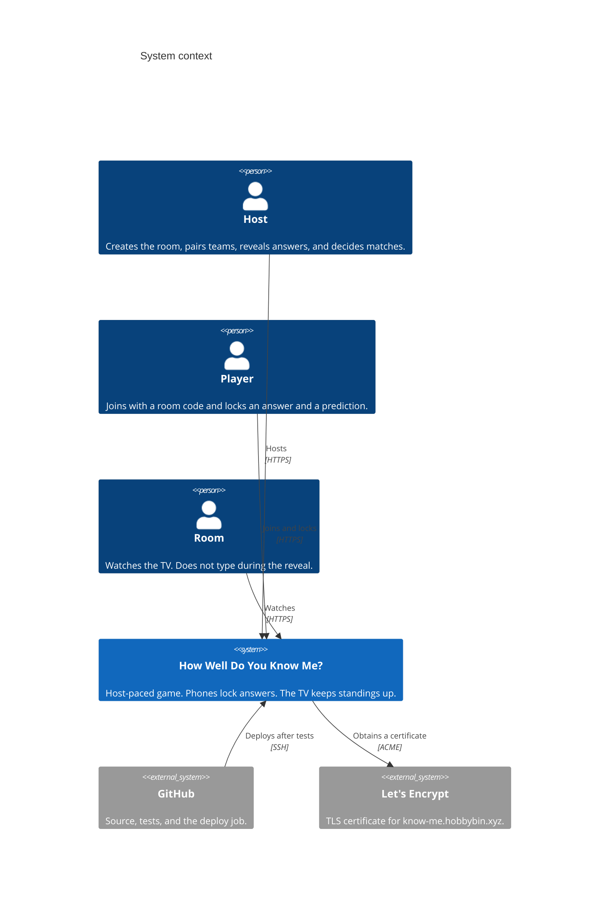
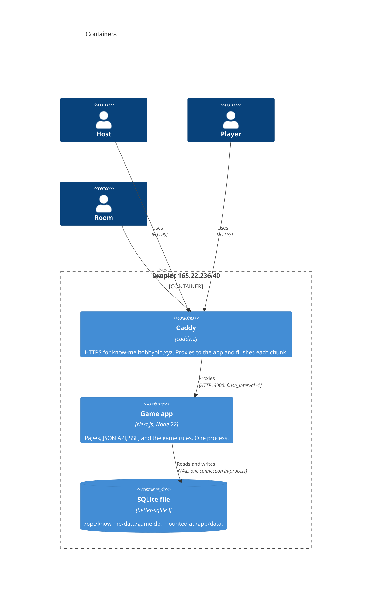
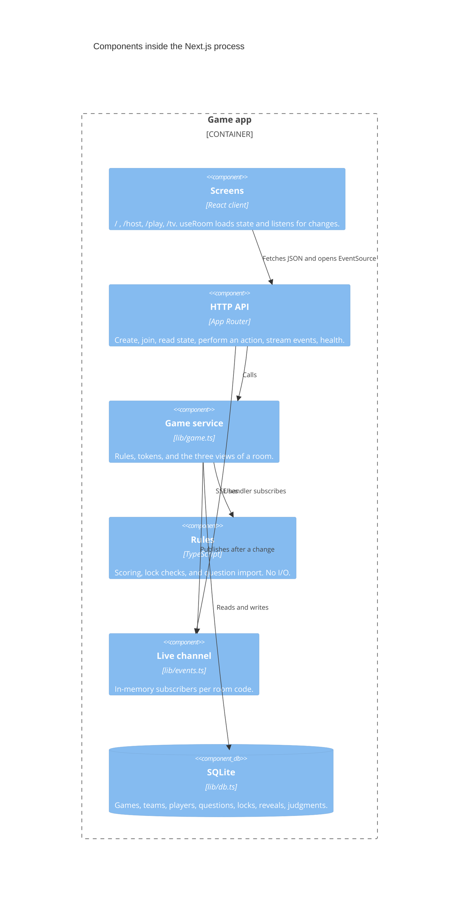

# Architecture

How Well Do You Know Me? is one Next.js application. Phones lock answers. The host judges matches. A TV shows the question, the reveals, and the standings for the whole game.

This note follows the [C4 model](https://c4model.com/): system context, containers, and components, then the decisions those views rest on. It matches the code on `main`, including the Docker and Caddy deploy.

## System context

A family uses three browsers against one site. Nobody has an account. GitHub is outside the game: it stores the code and, after tests pass on `main`, deploys it. Caddy asks Let's Encrypt for the certificate.

The host, each player, and the TV are the same web app on different routes (`/host`, `/play`, `/tv`). The room code is how they meet. The host token is a separate secret so a phone that only knows the code cannot judge or read locked answers early.

## Containers

Production is two containers on one droplet, defined in `deploy/docker-compose.yml`. The app container is a single Node process. SQLite and the live channel both live in that process, so the compose file does not scale it.

Caddy is the only process with public ports 80 and 443. The app is on the compose network and exposes 3000 to Caddy only. A health check calls `GET /health` inside the app container. Caddy starts after that check passes.

`/opt/know-me/.env` sets `DOMAIN` and nothing else. Compose sets `DATABASE_PATH`, `PORT`, and `NODE_ENV`. The sample question CSV is in the git checkout at `data/sample-questions.csv`, beside the database file on the mounted volume.

GitHub Actions does not build the image in CI. On a push to `main`, after tests, it SSHes to the droplet and runs `git pull --ff-only` and `docker compose up -d --build`. If `DROPLET_HOST` is unset, that job skips.

## Components

Inside the app container, the browser screens, the route handlers, and the game library share one Node process. The screens never import the database. They call HTTP and subscribe to server-sent events.

### Screens

| Route | Who | What it shows |
| --- | --- | --- |
| `/` | Anyone | How to play, and links to host, phone, and TV. |
| `/host` | Host | Teams, question picks, lock progress, both partners' answers during the reveal, match controls, undo, and the optional 3-minute cap. |
| `/play` | Player | Join, one question, two short fields, lock. After lock: watch the TV. |
| `/tv` | Room | Room code while setting up. Then the question, host-driven reveals, and standings for the whole game. |

`components/use-room.ts` loads `GET /api/games/:code` and opens `EventSource` on `/api/games/:code/events`. It also polls every two seconds, so a dropped stream still catches up from SQLite.

### HTTP

| Method and path | Auth | Effect |
| --- | --- | --- |
| `POST /api/games` | None | Creates a room. Returns the room code and host token. |
| `POST /api/games/:code/join` | None | Joins during setup. Returns a player token. |
| `GET /api/games/:code` | Optional | Host token, player token, or neither. The view depends on the token. |
| `POST /api/games/:code/action` | Host or player | One JSON action: teams, questions, start, lock, reveal, focus, judge, undo, advance, stall, dismiss hint. |
| `GET /api/games/:code/events` | None | Server-sent events. Each event says only `refresh`. |
| `GET /health` | None | `{ "ok": true }` for the container health check and curl. |

A missing or wrong token gets the TV view, not the host view. The TV view includes an answer only after the host has revealed that side. The player view includes that player's lock state and the current prompt, and never another person's text. The host view includes answer text only in the reveal and final phases.

### Game service and database

`lib/game.ts` is the only module that changes a room. Route handlers catch `GameError` and return its status. A mutation commits to SQLite, then `publish(code)` wakes SSE listeners.

Tables, created in `lib/db.ts`: `games`, `teams`, `players`, `questions`, `round_picks`, `answers`, `reveals`, `judgments`. A game moves through `setup`, `answering`, `revealing`, and `final`. There are two rounds of six questions. The host picks the six. Question 6 is the bonus.

`lib/scoring.ts` awards 1 point per matching direction on questions 1–5 and 3 on question 6. Both directions add up, so a question is worth at most 2 points, or 6 on the bonus. Ties share a competition rank (1, 1, 3) and are listed together. `lib/lock.ts` refuses an empty lock, a second lock, a lock outside the answer phase, and text over 120 characters. `lib/parse-questions.ts` accepts a `prompt,category` CSV or pasted lines with an optional `| category`.

## Decisions

### SQLite in one process

One family plays one room on one server. A separate database server would add a service the gathering does not need. `better-sqlite3` runs inside the Node process and stores one file, `data/game.db` locally and `/app/data/game.db` in the container. The file uses WAL mode. The host directory `/opt/know-me/data` is a volume, so a rebuild does not wipe games.

The live channel is a `Map` in that same process (`lib/events.ts`). A second app container would have its own map and its own SQLite lock. Compose therefore runs one app container, and the deploy does not scale it. Restarting the process keeps the database and drops in-memory subscribers. Clients poll, so they reload state after the process is back.

### Server-sent events, plus a poll

The TV and the host need to move when someone locks or the host reveals or scores. WebSockets would need a custom server beside Next.js. SSE is a normal `GET` that stays open, which fits the App Router and Caddy.

The event payload is only `refresh`. The client fetches the view it is allowed to see. That keeps answers out of a stream that anyone with the room code can open. Caddy sets `flush_interval -1` so those chunks are not buffered. A two-second poll covers a proxy that still holds the stream, and the gap after a restart.

### The host is the judge

"Shoes" and "sneakers" can be a match. The app does not compare strings. `judgments` stores the host's match or miss and the points for that direction. Points land on the team when the host marks a match, and the TV standings are the sum of those rows. Undo deletes the latest judgment on the current question, and only while that question is still in the reveal phase.

### Docker and Caddy

The droplet runs the image built from the repo `Dockerfile` and the `caddy:2` image. Caddy terminates TLS for `know-me.hobbybin.xyz` and proxies to `app:3000`. Certificate data is in named volumes. The app image is Node 22 on Debian slim, with the native module for `better-sqlite3` compiled at image build.

`GET /health` is how Compose knows the process can serve a request before Caddy depends on it. The public check is `curl https://know-me.hobbybin.xyz/health`.

Deploy is pull-and-rebuild on the droplet, not a copy of `node_modules` from GitHub Actions. Details and the pre-event checklist are in [SERVER-SETUP.md](SERVER-SETUP.md).

### No accounts

A gathering should not stop to register. Creating a game returns a host token. Joining returns a player token. Both sit in `localStorage` on that browser. The TV uses the room code alone.

Those tokens are bearer secrets, not user accounts. There is no password, no email, and no shared login. There is also no chat, no sound, and no automatic fuzzy match. Closing the tab does not unlock an answer: the row is in SQLite, and the player view stays locked after refresh.
